# Dylan Liu

  Staff at HQU · Information Security · IoT · Software Engineering

  <a href="https://blog.ourdocs.cn/">Blog</a> ·
  <a href="https://github.com/mentalfl0w">GitHub</a> ·
  <a href="mailto:mentalflow@ourdocs.cn">Email</a>

---

## About

I work at HQU and am interested in information security, IoT, and software engineering.

## GitHub activity

  
  

<picture>
  <source media="(prefers-color-scheme: dark)" srcset="./profile/cadence.dark.svg" />
  
</picture>

<picture>
  
</picture>

## Featured projects

  
  

- **DLLN3X ZigBee mesh module library** — A library for communicating with and configuring the DLLN3X ZigBee mesh module.
- **RibbonUI** — QML controls inspired by the Microsoft Ribbon interface.

## Contributions

<picture>
  <source media="(prefers-color-scheme: dark)" srcset="https://github.com/mentalfl0w/mentalfl0w/raw/snake/github-contribution-grid-snake-dark.svg" />
  <source media="(prefers-color-scheme: light)" srcset="https://github.com/mentalfl0w/mentalfl0w/raw/snake/github-contribution-grid-snake.svg" />
  
</picture>
